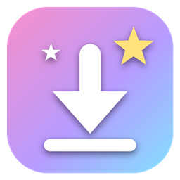

<p align="center">
  
</p>

<h1 align="center">Estela ✦</h1>

<p align="center">
  Descargador de videos de YouTube con fines educativos para Windows,<br>
  con Hoshi, tu asistente bajo un cielo de estrellas y pétalos de sakura.
</p>

<p align="center">
  <a href="https://github.com/xDaSerr/Estela/releases/latest"><b>⬇️ Descargar la última versión</b></a>
</p>

---

## Instalación

1. Ve a [Releases](https://github.com/xDaSerr/Estela/releases/latest) y descarga `Estela-Setup-x.x.x.exe`.
2. Ábrelo y sigue el asistente. No necesita permisos de administrador.
3. Si Windows muestra **"Windows protegió su PC"**, pulsa *Más información → Ejecutar de todas formas*
   (aparece porque el instalador no tiene firma digital de pago).

Requisitos: Windows 10 u 11 de 64 bits.

### Android

1. En [Releases](https://github.com/xDaSerr/Estela/releases/latest) descarga `Estela-x.x.x-android.apk`
   (si tu teléfono es antiguo y no se instala, prueba con `-android-32bits.apk` o `-android-universal.apk`).
2. Ábrelo y acepta **instalar apps de origen desconocido** cuando Android lo pida.
3. Para descargar desde la app de YouTube: *Compartir → Estela*.

Los archivos se guardan en **Descargas/Estela**. Requiere Android 10 o superior.
En los teléfonos más nuevos con páginas de memoria de 16 KB, Estela descarga formatos que no necesitan
FFmpeg (video MP4 en un solo archivo y audio M4A), porque la versión de FFmpeg incluida aún no es compatible.

## Funciones

- 🎬 Video en la mejor calidad (MP4), 📺 720p o 🎧 solo audio (MP3).
- Vista previa con miniatura, canal, duración y vistas.
- Indica si el video tiene licencia **Creative Commons**.
- **Se mantiene al día sola**: al abrirse actualiza yt-dlp (el motor de descargas),
  sus dependencias y Deno, para seguir funcionando cuando YouTube cambia algo.
  Si una actualización falla, vuelve a la versión incluida.

## Uso responsable

Estela está pensada para fines educativos. Descarga solo contenido que tengas permiso
de descargar: tus propios videos, material con licencia Creative Commons o con autorización
del autor. Respeta los derechos de autor y los Términos de Servicio de YouTube.

## Desarrollo

Necesitas Python 3.13 en Windows.

```bash
pip install -r requirements.txt
python app.py
```

| Archivo | Qué contiene |
|---|---|
| `app.py` | Ventana, búsqueda y descargas |
| `actualizador.py` | Actualización automática de yt-dlp, sus dependencias y Deno |
| `ui/index.html` | Toda la interfaz (diseño, Hoshi, animaciones) |
| `build.py` | Configuración de PyInstaller |
| `estela.iss` | Configuración del instalador (Inno Setup) |

**Crear el instalador:** instala [Inno Setup 6](https://jrsoftware.org/isinfo.php), sube la versión en
`estela.iss` (`MyAppVersion`) y ejecuta `crear_instalador.bat`. El resultado queda en `Instalador/`.

**Android** (`android/`): app en Kotlin que muestra la misma `ui/index.html` en un WebView y descarga con
[youtubedl-android](https://github.com/yausername/youtubedl-android). Ábrela con Android Studio o compila con
`gradlew.bat assembleRelease` dentro de `android/`. La firma se lee de `~/.estela/firma.properties`
(fuera del repositorio).

## Créditos

Hecho con [yt-dlp](https://github.com/yt-dlp/yt-dlp), [pywebview](https://pywebview.flowrl.com/),
[FFmpeg](https://ffmpeg.org/) y [Deno](https://deno.com/).

## Licencia

El código de Estela se distribuye bajo la licencia [MIT](LICENSE).

El instalador incluye un ejecutable de [FFmpeg](https://ffmpeg.org/) (obtenido de
[imageio-ffmpeg](https://github.com/imageio/imageio-ffmpeg)), que se distribuye bajo la licencia
[GPL](https://ffmpeg.org/legal.html) y se ejecuta como programa independiente. Su código fuente
está disponible en [ffmpeg.org](https://ffmpeg.org/download.html). Deno se descarga desde su fuente
oficial al usar la app y tiene licencia [MIT](https://github.com/denoland/deno/blob/main/LICENSE.md).
